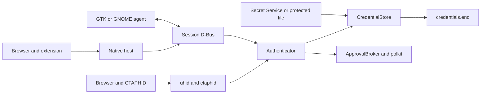

# Bitwarden: architecture audit and compatibility plan

Date: November 9, 2026. Inspected baseline: commit
`190774c83839ffc820c6425430f52f4b377e8c47`.

**Report status: research and technical proposal preceding implementation.**
The first subsequent increment is the manual import described in
[BITWARDEN-IMPORT.md](BITWARDEN-IMPORT.md). Statements below about missing
implementation record the state observed during the audit.
This document is not a compatibility claim. No Bitwarden login, real vault
access, import, or modification of the user's passkeys occurred during the audit.
Evidence about external interfaces is in
[BITWARDEN-INTERFACES.md](BITWARDEN-INTERFACES.md).

## Feasibility verdict

| Capability | Research result |
|---|---|
| Retrieve the original private key | Statically confirmed: JSON and the `bw list items` chain include PKCS#8 `keyValue`; a published version and disposable vault still need testing |
| Import without replacing the ID | Possible after adapting the store; impossible through the current `lookup()` |
| Use Linux password/biometrics for assertions | The local mechanism already exists; imported credentials still need independent WebAuthn proof |
| Public third-party OAuth for passkeys | Not found in the official interfaces examined; do not design a fictional flow |
| Native Linux CXP | Unconfirmed; the documented flow is mobile |
| Synchronize through the standard CLI without plaintext JSON tokens | Does not comply: the CLI can persist unencrypted access/refresh tokens in `data.json` |
| Respect desktop locking using `bw status` | Unproven: CLI and desktop states differ; status may attempt auto-unlock |
| EdDSA exported by Bitwarden | Unproven in the examined producer; the local authenticator already supports Ed25519, but that does not establish export support |

**Decision for this stage:** do not implement connection/synchronization through
the standard CLI as though it met the token storage requirement. The viable
independent path is explicit graphical import of official JSON, with validation
and confirmation. It does not require managing Bitwarden login, but also does
not provide automatic synchronization or track remote locking. The UI must
identify this alternative as importing a copy, never as a connected account.
Neither feature was implemented during this audit.

A future solution for CLI state must prove that secrets are not persisted in
plaintext, that reuse is authorized, and that locking semantics are correct
before enabling scheduling. Moving `data.json` to `/tmp` or tmpfs does not
encrypt its contents and does not, by itself, satisfy the requirement. Reusing
the desktop application's private files/sessions is not an official
authorization interface either.

## 1. Existing structure and flow

| Area | Responsibility and entry points |
|---|---|
| `linux_passkey/daemon.py` | Session process, GLib loop, asynchronous vault opening, recovery, device, and D-Bus service |
| `ctap2.py`, `pinuv.py`, `cbor.py` | CTAP 2.1 authenticator, commands, UV, permission/RP-scoped tokens, account selection, credential management |
| `ctaphid.py`, `uhid.py` | Framing, channels, keepalive/cancellation, and virtual FIDO device through `/dev/uhid` |
| `webauthn.py` | WebAuthn client for the extension: validates origin/RP ID, queries PSL, constructs `clientDataJSON` |
| `store.py`, `keys.py`, `masterkey.py`, `paths.py` | Self-contained IDs, encrypted metadata, cryptographic primitives, master key, atomic writes |
| `service.py`, `broker.py`, `verify.py` | D-Bus, approval prompts, and identity verification through polkit |
| `nativehost.py`, `browsers.py`, `browser-extension/` | Browser → native messaging → D-Bus transport and host registration |
| `app/` | GTK4/libadwaita manager, D-Bus client, and stand-alone approval window |
| `gnome-extension/` | Optional GNOME approval agent, not required on Niri |
| `data/`, `bin/`, `Makefile` | Launchers, systemd user unit, D-Bus activation, udev, polkit, icons, manuals, and installation |
| `debian/`, `packaging/`, `snap/` | Distribution packaging and Snap-specific restrictions |
| `tests/`, `.github/workflows/ci.yml`, `tools/` | pytest, FIDO/D-Bus integration, fuzzing, lint, packaging/publication |
| `po/`, `docs/`, `README.md` | gettext, product documentation, compliance audit, and manual test plan |

`Daemon.run()` owns the session name
`io.github.haythmkenway.Passkey.Daemon`. `Authenticator.execute()` serializes
USB and platform commands with a lock. `PasskeyService._ceremony()` runs
outside the GTK/GLib loop; cancellations are bound to the D-Bus sender and
operation handle. The HID transport also maintains keepalives during approval.
Bitwarden failures must remain outside this authentication path.

## 2. Existing credentials, cryptography, and invariants

### Creation and recovery

[store.py](../linux_passkey/store.py), `create()` and `lookup()`:

- The v1 ID contains an encrypted private key: version, AES-GCM nonce, and CBOR
  payload. Authenticated data includes the RP ID's SHA-256 hash.
- HKDF-SHA256 derives separate wrapping and file keys. The historical labels
  `ubuntu-passkey credential wrap` and `ubuntu-passkey store` are compatibility
  invariants and must not be renamed.
- ES256 uses P-256; EdDSA uses Ed25519. `keys.py` stores the 32-byte scalar/seed
  and derives the COSE public key; it does **not** read PKCS#8 directly.
- `lookup()` only attempts to decrypt local IDs. A legitimate external ID will
  be rejected even if its metadata is inserted into the file.
- Local non-discoverable credentials can be recovered without a record.
  A discoverable credential requires its record to remain present; deletion
  revokes its use in this authenticator.

### Metadata and persistence

`credentials.enc` is a version 1 AES-256-GCM envelope containing encrypted JSON.
It contains `counter` and `credentials`; each record has an ID, RP, user handle,
names, algorithm, credProtect, timestamps, and usage count. There is no source,
remote account, synchronization history, BE/BS state, or external key.

`CredentialStore._save()` uses `paths.atomic_write()`: a temporary file in the
same directory, mode 0600, flush, file fsync, and `os.replace`. The temporary
file contains ciphertext. The directory is created with mode 0700. There is an
in-process `RLock`, but no protocol for multiple writers across processes.

**Limitations relevant to import:**

1. `add_resident()` replaces records with the same RP ID and user handle,
   including those with a different ID. The test
   `test_same_account_replaces_old_passkey` confirms this is intentional for
   local creation. Do not reuse this method for import: it could delete an
   existing passkey.
2. Current mutations happen before `_save()`. A write failure can leave memory
   different from disk. Atomic renaming is not an import transaction with
   in-memory rollback.
3. The current fsync does not cover the directory after renaming. Durability
   guarantees against power loss require separate handling of that step.
4. `list()` and `record()` return shallow copies of records. Do not add private
   material to structures that might conveniently become public responses.
   The public list must continue to use an explicit projection.

### Master key, deletion, and recovery

[masterkey.py](../linux_passkey/masterkey.py), `MasterKeyManager`:

- Prefers Secret Service/libsecret; the selected backend is recorded in
  `key-backend`. The existing fallback is a file backend, `master.key`, mode 0600.
- If the recorded backend is unavailable, it does not generate a replacement
  key. This avoids silently invalidating existing credentials.
- The daemon stays available with a storage error and offers retry. Reset
  rotates the key and removes credentials; it is not part of the integration.
- Subsequently locking the keyring does not remove keys already loaded in the
  daemon's memory. The project does not continuously monitor that lock state.

The integration must not use `reset()`, `rotate()`, or backend reconfiguration
to solve Bitwarden authentication problems. Deleting an imported copy does not
revoke the original in Bitwarden or its registration with the website.

## 3. Signatures, flags, extensions, and WebAuthn

[ctap2.py](../linux_passkey/ctap2.py), `_auth_data()` and `_assertion()`:

- A persisted global counter increments whenever authData is generated.
  `use_count` is only a UI statistic, not the WebAuthn signCount.
- Implemented flags are UP, UV, AT, and ED; BE/BS are not represented.
- Signing uses the recovered key and covers authData + clientDataHash.
- The user handle comes from the record. Names are conditional on UV.
- The hmac-secret/PRF seed belongs to the local payload; an import without that
  secret cannot invent it and claim continuity of the original extension.
- GetInfo advertises `MAX_CRED_ID_LENGTH=128`. Supporting external IDs requires
  reviewing input and advertised limits without truncating or replacing IDs.

[WebAuthn Level 3](https://www.w3.org/TR/webauthn-3/#sctn-credential-backup)
defines BE as a permanent property and BS as current state; BS cannot be true
when BE is false. The counter may remain zero when the authenticator does not
provide counter-based detection. This does not authorize arbitrarily resetting
a nonzero counter or coordinating counters across copies through read-only
synchronization.

**Consequence:** credentials copied from Bitwarden need their own verified
BE/BS and counter policy; they cannot pass unchanged through the local path
and appear to be device-bound credentials. Test the policy against the
producer version's semantics, rather than inferring it from a field name alone.

[webauthn.py](../linux_passkey/webauthn.py), `check_rp_id()`, `get()`, and
`has_credentials()` remain responsible for origin, PSL, and clientDataJSON.
The importer validates the RP in imported material but does not replace origin
checks for each authentication. The background script uses the origin supplied
by the browser; cross-origin frames are left to the native browser.

## 4. Presence, biometrics, and authorization boundaries

[broker.py](../linux_passkey/broker.py) selects a D-Bus agent or opens the GTK
prompt. Its payload is sent through stdin rather than the command line.
[verify.py](../linux_passkey/verify.py) runs `pkcheck` for the daemon process's
identity. The installed policy uses uncached `auth_self`. Biometrics depend on
the polkit agent and the system's PAM/fprintd configuration; the project has no
biometric implementation of its own.

[service.py](../linux_passkey/service.py) exposes the list through
`describe_record()`, an allowlist without private keys. Agent registration does
not establish an application's identity: any process in the session can request
registration. `DeleteCredential` does not require polkit; ResetAll requires the
configured verification; D-Bus settings have a restricted allowlist. These
existing behaviors are not sufficient authorization for a new private-key
import operation.

Import requires specific consent to an immutable preview, sender identification,
expiry, non-reusable confirmation, and mandatory polkit that fails closed.
Do not accept `authorized=true` from the client or allow `verification=none`
to authorize imports. Validate limits and format before loading keys, but
authorize before persisting/using the batch.

D-Bus is session IPC, not isolation from all processes under the same UID.
Secret Service also does not protect against total session compromise. The
threat model must state this boundary without promising protection against
root or arbitrary reads of process memory.

## 5. GTK4, Niri, and deployment

[app/window.py](../linux_passkey/app/window.py) uses `Adw.PreferencesPage` with
passkey, security, and status groups. There is currently no settings or
integrations page hierarchy. The client
[app/client.py](../linux_passkey/app/client.py) provides synchronous methods and
`call_async()`. State changes are updated through D-Bus signals and
`GLib.idle_add`, without continuously polling the list.

The new page should reuse ActionRow, ComboRow, SwitchRow, AlertDialog,
ToastOverlay, and gettext strings; include accessible names, escape markup in
external data, and use asynchronous operations. Local/Bitwarden source should
appear both in the list and in details. Never show keys or sessions in errors.

On CachyOS/Niri, use the stand-alone approval window and a session polkit agent.
GNOME Shell is not a prerequisite. Secret Service, GTK4/libadwaita, and polkit
are installed; `bw` was not found in PATH during this audit.

**Confirmed architecture restriction:**
[data/linux-passkey.service.in](../data/linux-passkey.service.in) restricts
address families to `AF_UNIX AF_NETLINK`. A `bw` subprocess inherits the sandbox
and does not gain HTTPS access. Adding a thread or environment variable is
not enough to make daemon-side synchronization work. The proposal is to run
network access in a separate session helper and keep local keys in the daemon;
do not silently broaden the authenticator's permissions. Snap requires its own
interface/packaging analysis before claiming support.

## 6. Change map for subsequent phases

This is a proposal, not existing class names or implemented code.

| Owner | Minimum safe change |
|---|---|
| Bitwarden adapter | Detect CLI version/capabilities, official login/MFA, session state, sync, and reading; bounded output and sanitized errors |
| Authorization/session | Password only during the operation, volatile session by default; opt-in Secret Service persistence without file fallback; documented disconnect and lock semantics |
| Mapper | Verified JSON/CXF → normalized data, PKCS#8 parsing through `cryptography`, ID/RP/handle/algorithm/backup/extension validation |
| `CredentialStore` | External ID + RP lookup before local unwrap; encrypted external key; batch commit, source, idempotency, and rollback snapshot |
| `Authenticator` | Flags and counter policy per imported credential, preserving local credentials' path and values |
| Import/reconciliation | Preview, per-entry rejection, confirmation of the exact batch; comparison by cryptographic identity and source; deletions treated as conflicts |
| Scheduler | One reschedulable GLib timer and one active worker; bounded network backoff; pause on lock/expiry; cancel on disconnect |
| D-Bus | Public state/summaries only; authorized privileged operations; no session/private-key return values |
| GTK | Integrations → Bitwarden: account, state, actions, preview, conflicts, frequency, last run, and history |
| Packaging/documentation | Optional CLI, network helper, and Arch/Niri instructions; update `po/POTFILES` if UI modules are added |

There is no justification for a new SQL database, another AES implementation,
or a generic provider framework at this point. Cryptographic material remains
under the existing mechanism; `cryptography` already provides PKCS#8 parsing.
Require an available keyring backend for imported copies; do not change the
existing fallback for local passkeys or present a file-based key as keyring
protection. This condition must appear in the preview.

## 7. Proposed data model and migration

Keep the AES-GCM envelope and HKDF labels. The new reader accepts v1 files;
v1 records are treated as `source=local` without rewriting their IDs. Only the
first commit requiring external data activates the new version.

An external record must preserve the original binary ID (canonically encoded
for indexing), RP, user handle, normalized key/algorithm, `bitwarden` source,
remote account/server/item linkage, BE/BS, counter policy, timestamps, and remote
revision. History, reconciliation state, and sensitive account data belong
inside the encrypted contents; non-secret preferences can remain in the
existing Config. Master passwords and tokens do not belong in this file.

**Do not overwrite an entry merely because RP+user match.** The same identity
with a different key or RP is a conflict. The same ID/key/RP is idempotent;
if already local, import does not take ownership of that credential. Remote
name changes must not overwrite usage statistics, counters, or local overrides.

| Stage | Writers/readers and recovery |
|---|---|
| Expand | New reader understands v1 and v2; v1 stays usable without import; test with fixtures from the original code |
| Prepare | Validate the full batch in memory; bind preview to the store revision; encrypted snapshot under the existing key; one writer |
| Commit | Revalidate revision under lock; encrypt candidate; write/rename atomically; replace in-memory state only after success; signal after commit |
| Verify | Reopen the file, authenticate an old local credential and a synthetic external one, demonstrate wrong-RP rejection and no keys exposed through D-Bus |
| Rollback | Before commit, discard candidate; after commit, restore snapshot only with the daemon stopped and without discarding later changes without consent |

**Downgrade boundary:** the original binary cannot use external IDs and can
replace records for the same RP/user. Do not run old and new versions as
concurrent writers. A v2 format must fail closed in the original program.
This preserves old credentials in the new program but does not promise that
the original program can use imported passkeys. No destructive migration or
contraction is authorized at this stage.

## 8. Proposed synchronization and states

Manual, on application startup, every 15/30/60 minutes, or disabled. Periodic
scheduling belongs to a defined session owner rather than each window;
opening two windows must not create two workers. Startup mode must mean
application activation, not every page refresh.

Flow: check availability and session → complete remote sync → read and validate
→ preview on the first run → confirmation → transactional commit → sanitized
history. Do not infer remote changes when sync/reading fails. Manual import
of a partial file is **not** a complete remote snapshot and cannot generate
deletions.

Distinct states: unavailable, disconnected, authentication/MFA required, waiting
for unlock, ready, synchronizing, network unavailable, session expired,
incompatible format, and conflicts. Lock/expiry suspend operations until valid
user action; timers must not open repeated authentication prompts.

Remote removals produce a divergence and never delete automatically. Local
deletion leaves source-linked suppression so the next sync does not resurrect
the copy without an explicit decision. Disconnect removes authorization and
cancels jobs; removing already imported copies is a separate decision. There
is no write-back flow to Bitwarden.

Locking remote access does not automatically revoke local copies. If the
product should also block local authentication with those copies, it needs
an explicit policy and reliable lock observation. Local polkit does not
replace Bitwarden's cryptographic unlock.

## 9. Tests before implementation

Use pytest, temporary XDG locations, and credentials generated for testing,
as in the current suite. CLI mocks test the contract but do not establish
compatibility with a Bitwarden vault. A real contract test needs an authorized
disposable account/vault and a pinned CLI version, never the user's personal
account.

| Group | Proof required to release the implementation |
|---|---|
| Auth | Valid/invalid login, MFA, expiry, lock, reconnect/disconnect; inspect argv/env/logs/files; session persisted only after opt-in |
| Mapper | ES256; EdDSA only if supported by the producer; UUID/raw IDs according to official code; invalid PKCS#8 key, incompatible curve/algorithm, missing RP/handle, inconsistent backup state |
| Store | Original external ID; wrong RP; existing v1 file; duplicates/conflicts; same account with local credentials; memory/disk rollback; fsync/rename denied; no private temporary files |
| Sync | First batch with preview; no changes; new item; metadata; remote removal; local deletion; partial snapshot; network failure; concurrency; expiry; interruption before/after commit |
| WebAuthn | `Fido2Server` knows the test public key before import; authentication through `webauthn.get` and CTAPHID validates original ID, RP, signature, UP/UV, BE/BS, and counter; reject hostile origins |
| D-Bus | Unauthorized caller cannot import; wrong/expired/other-sender confirmation token fails; list/status/history expose no private material; cancellation disconnects the operation |
| UI | States, preview, accessibility, sanitized errors, account, and source; no network operation blocks GTK |

The WebAuthn oracle must be independent: construct the server record from the
fixture's public key, without using `store.create()` or replacing an imported
key with a newly generated one. Test copies used by two authenticators;
do not validate only a signature's happy path.

## 10. Verification at this stage

- `make check`: **129 tests passed**, including two Firefox XDG tests produced
  in the previous task. There were 27 GLib/PyGObject deprecation warnings and
  no failures. D-Bus tests needed to run outside the sandbox to create their
  private bus.
- `make lint`: **passed** after installing pyflakes and allowing the existing
  target to download ESLint 9.15.0. AppStream, desktop-file, Python, JavaScript,
  and the polkit policy were validated. Warnings: deprecated ESLint version
  and unavailable external polkit DTD reference; `xmllint` used the local DTD
  explicitly selected by the Makefile and returned success.
- No Bitwarden import or authentication tests were created/run: the feature's
  test phase had not started yet.
- The development dependency `pyflakes` was installed only in `.venv` to run
  the lint target. No runtime dependency was added.
- `linux_passkey/browsers.py` and `tests/test_nativehost.py` were already modified
  by the preceding Firefox fix; they are not a Bitwarden implementation.
- There was no migration, deletion, ID/key change, or write to the Bitwarden
  vault. The installed program retained its existing behavior.

Next technical step: finalize the CLI session/lock and persistence contract
using the external evidence, choose the alternative that meets the security
requirements, and write its acceptance tests before changing storage.
