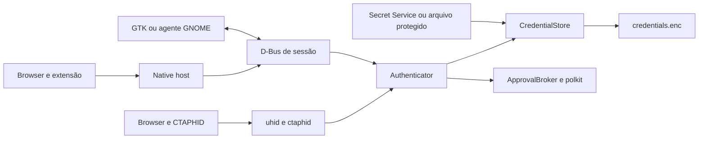

# Bitwarden: auditoria de arquitetura e plano de compatibilidade

Data: 9 de novembro de 2026. Base inspecionada: commit
`190774c83839ffc820c6425430f52f4b377e8c47`.

**Estado: investigação e proposta técnica; integração ainda não implementada.**
Este documento não é uma declaração de compatibilidade. Não houve login no
Bitwarden, acesso a cofre real, importação ou alteração de passkeys do usuário.
As evidências das interfaces externas estão em
[BITWARDEN-INTERFACES.md](BITWARDEN-INTERFACES.md).

## Veredito de viabilidade

| Capacidade | Resultado da investigação |
|---|---|
| Recuperar chave privada original | Confirmado estaticamente: JSON e cadeia `bw list items` incluem `keyValue` PKCS#8; falta teste com versão publicada e cofre descartável |
| Importar sem trocar o ID | Possível após adaptar o store; impossível pelo `lookup()` atual |
| Usar senha/biometria Linux nas asserções | O mecanismo local já existe; a credencial importada ainda precisa da prova WebAuthn independente |
| OAuth público de terceiros para passkeys | Não localizado nas interfaces oficiais examinadas; não projetar um fluxo fictício |
| CXP nativo Linux | Não confirmado; o fluxo documentado é móvel |
| Sincronizar pelo CLI comum sem tokens em JSON claro | Não atende: o CLI pode persistir access/refresh tokens em `data.json` sem cifra |
| Respeitar o bloqueio do desktop usando `bw status` | Não comprovado: CLI e desktop têm estados distintos; status pode tentar auto-unlock |
| EdDSA exportada pelo Bitwarden | Não comprovada no produtor examinado; Ed25519 já existe no autenticador local, mas isso não prova suporte de exportação |

**Decisão desta etapa:** não implementar conexão/sincronização com o CLI padrão
como se cumprisse o requisito de armazenamento de tokens. O caminho independente
viável é importação gráfica explícita de JSON oficial, com validação e
confirmação. Ele não exige gerenciar login Bitwarden, mas também não entrega
sincronização automática nem acompanha o bloqueio remoto. Essa alternativa deve
ser identificada na interface como importação de cópia, nunca como conta
conectada. Nenhuma das duas funcionalidades foi implementada nesta auditoria.

Uma solução futura para o estado da CLI precisa provar ausência de segredos
persistidos em claro, reutilização autorizada e semântica de bloqueio antes de
ativar agendamento. Mover `data.json` para `/tmp` ou tmpfs não cifra seu conteúdo
e não é, por si só, cumprimento da regra. Reutilizar arquivos/sessões privadas
do aplicativo desktop também não é uma interface oficial de autorização.

## 1. Estrutura e fluxo existente

| Área | Responsabilidade e pontos de entrada |
|---|---|
| `linux_passkey/daemon.py` | Processo de sessão, ciclo GLib, abertura assíncrona do cofre, recuperação, dispositivo e serviço D-Bus |
| `ctap2.py`, `pinuv.py`, `cbor.py` | Autenticador CTAP 2.1, comandos, UV, tokens por permissões/RP, seleção de contas, gerenciamento de credenciais |
| `ctaphid.py`, `uhid.py` | Framing, canais, keepalive/cancelamento e dispositivo virtual FIDO via `/dev/uhid` |
| `webauthn.py` | Cliente WebAuthn para a extensão: valida origem/RP ID, consulta PSL, constrói `clientDataJSON` |
| `store.py`, `keys.py`, `masterkey.py`, `paths.py` | IDs autocontidos, metadados cifrados, primitivas criptográficas, chave mestra e escrita atômica |
| `service.py`, `broker.py`, `verify.py` | D-Bus, prompts de aprovação e comprovação de identidade via polkit |
| `nativehost.py`, `browsers.py`, `browser-extension/` | Transporte browser → native messaging → D-Bus e registro dos hosts |
| `app/` | Gerenciador GTK4/libadwaita, cliente D-Bus e janela de aprovação independente |
| `gnome-extension/` | Agente de aprovação GNOME opcional, não necessário no Niri |
| `data/`, `bin/`, `Makefile` | Launchers, systemd user, ativação D-Bus, udev, polkit, ícones, manuais e instalação |
| `debian/`, `packaging/`, `snap/` | Empacotamento por distribuição e restrições específicas do Snap |
| `tests/`, `.github/workflows/ci.yml`, `tools/` | pytest, integração FIDO/D-Bus, fuzzing, lint e empacotamento/publicação |
| `po/`, `docs/`, `README.md` | gettext, documentação do produto, auditoria de conformidade e plano de testes manuais |

`Daemon.run()` possui o nome de sessão
`io.github.haythmkenway.Passkey.Daemon`. `Authenticator.execute()` serializa
comandos USB e plataforma com um lock. `PasskeyService._ceremony()` trabalha
fora do loop GTK/GLib; os cancelamentos são vinculados ao remetente D-Bus e ao
identificador da operação. O transporte HID também mantém keepalives durante
aprovação. Uma falha no Bitwarden deve ficar fora desse caminho de autenticação.

## 2. Credenciais, criptografia e invariantes existentes

### Criação e recuperação

[store.py](../linux_passkey/store.py), `create()` e `lookup()`:

- O ID v1 contém uma chave privada cifrada: versão, nonce AES-GCM e payload CBOR.
  A informação autenticada inclui o hash SHA-256 do RP ID.
- HKDF-SHA256 deriva chaves distintas para wrapping e arquivo. Os rótulos
  históricos `ubuntu-passkey credential wrap` e `ubuntu-passkey store` são
  invariantes de compatibilidade; não podem ser renomeados.
- ES256 usa P-256; EdDSA usa Ed25519. `keys.py` armazena o escalar/semente de
  32 bytes e deriva a chave pública COSE; **não** lê PKCS#8 diretamente.
- `lookup()` tenta decifrar exclusivamente IDs locais. Um ID legítimo externo
  será recusado, mesmo que seus metadados sejam colocados no arquivo.
- Credenciais locais não descobríveis podem ser recuperadas sem um registro.
  Uma credencial descobrível exige que seu registro ainda exista; a exclusão
  revoga seu uso neste autenticador.

### Metadados e persistência

`credentials.enc` é um envelope AES-256-GCM com versão 1 e JSON cifrado. Contém
`counter` e `credentials`; cada registro tem ID, RP, user handle, nomes,
algoritmo, credProtect, datas e número de utilizações. Não há origem, conta
remota, histórico de sincronização, estados BE/BS nem chave externa.

`CredentialStore._save()` usa `paths.atomic_write()`: temporário no mesmo
diretório, modo 0600, flush, fsync do arquivo e `os.replace`. O temporário
contém ciphertext. O diretório é criado com modo 0700. Há `RLock` dentro do
processo, mas não há protocolo de múltiplos escritores entre processos.

**Limitações relevantes para a importação:**

1. `add_resident()` substitui registros com o mesmo RP ID e user handle,
   inclusive com ID diferente. O teste `test_same_account_replaces_old_passkey`
   confirma que isso é intencional para a criação local. Não reutilizar esse
   método para importar: ele poderia apagar uma passkey preexistente.
2. As mutações atuais acontecem antes de `_save()`. Uma falha de gravação pode
   deixar a memória diferente do disco. Renomeação atômica não equivale a uma
   transação de importação com rollback de memória.
3. O fsync atual não abrange o diretório após a renomeação. Garantia de
   durabilidade diante de queda de energia requer esse tratamento separado.
4. `list()` e `record()` retornam cópias rasas dos registros. Não adicionar
   material privado a estruturas que possam virar respostas públicas por
   conveniência. A lista pública deve continuar usando uma projeção explícita.

### Chave mestra, exclusão e recuperação

[masterkey.py](../linux_passkey/masterkey.py), `MasterKeyManager`:

- Prefere Secret Service/libsecret; o backend selecionado fica registrado em
  `key-backend`. Backend de arquivo é fallback existente, em `master.key` 0600.
- Se o backend registrado não está disponível, não gera uma chave substituta.
  Isso evita invalidar silenciosamente as credenciais existentes.
- O daemon fica disponível com erro de armazenamento e oferece nova tentativa.
  Reset gira a chave e remove as credenciais; não faz parte da integração.
- Bloquear posteriormente o chaveiro não elimina chaves já carregadas na
  memória do daemon. O projeto não monitora esse bloqueio continuamente.

A integração não deve usar `reset()`, `rotate()` ou reconfigurar o backend para
resolver problemas de autenticação Bitwarden. Excluir uma cópia importada não
revoga a original no Bitwarden nem o cadastro no site.

## 3. Assinaturas, flags, extensões e WebAuthn

[ctap2.py](../linux_passkey/ctap2.py), `_auth_data()` e `_assertion()`:

- Há um contador global persistido, incrementado a cada geração de authData.
  `use_count` é apenas uma estatística da interface, não o signCount WebAuthn.
- As flags implementadas são UP, UV, AT e ED; BE/BS não são representadas.
- A assinatura usa a chave recuperada e cobre authData + clientDataHash.
- O user handle é devolvido a partir do registro. Nomes são condicionados à UV.
- O seed hmac-secret/PRF pertence ao payload local; uma importação sem esse
  segredo não pode inventá-lo e afirmar continuidade da extensão original.
- `MAX_CRED_ID_LENGTH=128` é anunciado em GetInfo. O suporte a IDs externos
  precisa revisar limites de entrada e anúncio, sem truncar ou trocar IDs.

[WebAuthn Level 3](https://www.w3.org/TR/webauthn-3/#sctn-credential-backup)
define BE como propriedade permanente e BS como estado atual; BS não pode ser
verdadeiro quando BE é falso. O contador pode permanecer em zero quando o
autenticador não fornece detecção por contador. Isso não autoriza reiniciar um
contador não nulo arbitrariamente nem coordenar contadores entre cópias por
meio de uma sincronização apenas de leitura.

**Consequência:** credenciais copiadas do Bitwarden precisam de política
própria comprovada de BE/BS e contador; não podem passar pelo caminho local
inalterado e parecer credenciais device-bound. A política deve ser testada
contra a semântica da versão do produtor, não deduzida apenas do nome do campo.

[webauthn.py](../linux_passkey/webauthn.py), `check_rp_id()`, `get()` e
`has_credentials()`, permanece responsável por origem, PSL e clientDataJSON.
O importador valida o RP do material importado, mas não substitui as checagens
de origem de cada autenticação. O script de background usa a origem fornecida
pelo navegador; frames cross-origin seguem para o navegador nativo.

## 4. Presença, biometria e limites de autorização

[broker.py](../linux_passkey/broker.py) seleciona um agente D-Bus ou abre o
prompt GTK. O payload do prompt é enviado por stdin, não pela linha de comando.
[verify.py](../linux_passkey/verify.py) executa `pkcheck` para a identidade do
processo do daemon. A política instalada usa `auth_self` sem cache. Biometria
depende do agente polkit e da configuração PAM/fprintd do sistema; não existe
implementação biométrica própria.

[service.py](../linux_passkey/service.py) expõe a lista através de
`describe_record()`, uma allowlist sem chaves privadas. O registro de agentes
não é comprovação de identidade de um aplicativo: qualquer processo da sessão
pode pedir registro. `DeleteCredential` não exige polkit; ResetAll exige a
verificação configurada; as configurações D-Bus têm allowlist restrita.
Esses comportamentos existentes não constituem autorização suficiente para
uma nova operação de importação de chaves privadas.

Para importar, são necessários consentimento específico sobre uma prévia
imutável, identificação do remetente, expiração, confirmação não reutilizável e
polkit obrigatório com falha fechada. Não aceitar `authorized=true` do cliente
nem deixar `verification=none` autorizar importações. Validar limites e formato
antes de carregar chaves, mas autorizar antes de persistir/usar o lote.

D-Bus é um IPC da sessão, não isolamento contra todos os processos do mesmo
UID. Secret Service também não protege contra comprometimento total dessa
sessão. O modelo de ameaças precisa declarar esse limite, sem prometer proteção
contra root ou leitura arbitrária da memória do processo.

## 5. GTK4, Niri e implantação

[app/window.py](../linux_passkey/app/window.py) usa `Adw.PreferencesPage` com
grupos de passkeys, segurança e status. Não há hoje uma árvore de páginas de
configuração ou integrações. O cliente [app/client.py](../linux_passkey/app/client.py)
oferece métodos síncronos e `call_async()`. Mudanças de estado são atualizadas
por sinais D-Bus e `GLib.idle_add`, sem polling contínuo da lista.

A nova página deve reutilizar ActionRow, ComboRow, SwitchRow, AlertDialog,
ToastOverlay e strings gettext; incluir nomes acessíveis, escape de markup de
dados externos e operações assíncronas. Origem local/Bitwarden deve aparecer
tanto na lista quanto nos detalhes. Não exibir chaves ou sessão em erros.

No CachyOS/Niri, usar a janela de aprovação independente e um agente polkit da
sessão. O GNOME Shell não é pré-requisito. Há Secret Service, GTK4/libadwaita e
polkit instalados; `bw` não foi encontrado no PATH desta auditoria.

**Restrição de arquitetura confirmada:**
[data/linux-passkey.service.in](../data/linux-passkey.service.in) restringe
endereços a `AF_UNIX AF_NETLINK`. Um subprocesso `bw` herda o sandbox e não ganha
acesso HTTPS. Sincronização no daemon não funcionará apenas adicionando uma
thread ou variável de ambiente. A proposta é executar a parte de rede em um
helper de sessão separado e manter as chaves locais no daemon; não ampliar
silenciosamente as permissões do autenticador. O Snap exige análise própria
de interfaces/empacotamento antes de declarar suporte.

## 6. Mapa de alterações para as próximas fases

Esta é uma proposta, não nomes de classes já existentes nem código implementado.

| Responsável | Alteração mínima segura |
|---|---|
| Adaptador Bitwarden | Detectar versão/capacidade do CLI, login oficial/MFA, estado de sessão, sync e leitura; saída limitada e erros sanitizados |
| Autorização/sessão | Senha apenas durante operação, sessão volátil por padrão; persistência opt-in no Secret Service sem fallback em arquivo; desconexão e semântica de lock documentadas |
| Mapper | JSON/CXF comprovado → dados normalizados, parsing PKCS#8 via `cryptography`, validação de ID/RP/handle/algoritmo/backup/extensões |
| `CredentialStore` | Busca por ID externo + RP antes do unwrap local; chave externa cifrada; commit em lote, origem, idempotência e snapshot para rollback |
| `Authenticator` | Flags e política de contador por credencial importada, preservando o caminho e valores das credenciais locais |
| Importação/reconciliação | Prévia, rejeições por item, confirmação do lote exato; comparação por identidade criptográfica e origem; exclusões como conflito |
| Scheduler | Um único timer GLib reagendável e um worker ativo; backoff limitado para rede; pausa por lock/expiração; cancelamento em disconnect |
| D-Bus | Somente estado/resumos públicos; operações privilegiadas com autorização; não adicionar retorno de sessão/chave privada |
| GTK | Integrações → Bitwarden: conta, estado, ações, prévia, conflitos, frequência, última execução e histórico |
| Empacotamento/documentação | CLI opcional, helper de rede e instruções Arch/Niri; atualizar `po/POTFILES` se houver novos módulos de interface |

Não há justificativa para novo banco SQL, outra implementação AES ou um
framework genérico de provedores neste momento. O material criptográfico
continua sob o mecanismo existente; `cryptography` já fornece parsing PKCS#8.
Para as cópias importadas, exigir o backend keyring disponível; não alterar o
fallback já existente para as passkeys locais nem apresentar uma chave em
arquivo como proteção pelo keyring. Essa condição deve aparecer na prévia.

## 7. Modelo de dados e migração proposta

Manter o envelope AES-GCM e os rótulos HKDF. O leitor novo aceita arquivos v1;
os registros v1 são tratados como `source=local` sem reescrever seus IDs.
Somente o primeiro commit que precisa de dados externos ativa a versão nova.

Um registro externo precisa conservar ID original binário (codificado de forma
canônica para índice), RP, user handle, chave/algoritmo normalizados, origem
`bitwarden`, vínculo de conta/servidor/item remoto, BE/BS, política de contador,
datas e revisão remota. Histórico, estado de reconciliação e dados sensíveis de
conta ficam no conteúdo cifrado; preferências não secretas podem ficar no
Config existente. Senha mestra e tokens não entram nesse arquivo.

**Não sobrescrever uma entrada por igualdade de RP+usuário.** A mesma identidade
com chave ou RP diferente é conflito. Mesmo ID/chave/RP é idempotente; se já é
local, a importação não assume posse da credencial. Alterações de nomes remotos
não devem sobrescrever estatísticas de uso, contadores ou overrides locais.

| Etapa | Escritores/leitores e recuperação |
|---|---|
| Expandir | Novo leitor entende v1 e v2; v1 continua utilizável sem importação; teste com fixtures do código original |
| Preparar | Validar lote completo em memória; prévia vinculada à revisão do store; snapshot cifrado com a chave existente; um escritor |
| Commit | Revalidar revisão sob lock; cifrar candidato; escrever/renomear atomicamente; trocar estado em memória apenas após sucesso; emitir sinal após commit |
| Verificar | Reabrir o arquivo, autenticar credencial local antiga e externa fictícia, demonstrar negação por RP errado e ausência de chave em D-Bus |
| Rollback | Antes do commit, descartar candidato; após commit, restaurar snapshot somente com daemon parado e sem descartar mudanças posteriores sem consentimento |

**Limite de downgrade:** o binário original não sabe usar IDs externos e pode
substituir registros do mesmo RP/usuário. Não executar versões antigas e novas
como escritores concorrentes. Um formato v2 deve falhar fechado no original.
Isso preserva credenciais antigas no programa novo, mas não promete que o
programa original consiga usar passkeys importadas. Não existe migração
destrutiva ou contração autorizada nesta etapa.

## 8. Sincronização e estados propostos

Manual, ao iniciar o aplicativo, 15/30/60 minutos ou desativada. O agendamento
periódico pertence a um proprietário de sessão definido, não a cada janela;
abrir duas janelas não cria dois workers. O modo ao iniciar o aplicativo deve
significar ativação do aplicativo, não cada refresh da página.

Fluxo: verificar disponibilidade e sessão → sync remoto completo → leitura e
validação → prévia na primeira execução → confirmação → commit transacional →
histórico sanitizado. Nenhuma alteração remota é inferida se sync/leitura falha.
Importação manual de arquivo parcial **não** representa um snapshot remoto
completo e não pode gerar exclusões.

Estados distinguíveis: indisponível, desconectado, autenticação/MFA necessária,
aguardando desbloqueio, pronto, sincronizando, rede indisponível, sessão expirada,
formato incompatível e conflitos. Lock/expiração suspendem operações até ação
válida do usuário; não abrem prompts repetidamente pelo timer.

Remoções remotas geram divergência e nunca apagam automaticamente. Exclusão
local deixa supressão vinculada à origem para que o próximo sync não ressuscite
a cópia sem decisão explícita. Desconectar remove autorização e cancela jobs;
remover cópias já importadas é uma decisão separada. Não há fluxo de escrita
para o Bitwarden.

Bloqueio de acesso remoto não é automaticamente revogação das cópias locais.
Se o produto quiser bloquear também autenticações locais dessas cópias, isso
exige política explícita e observação confiável de lock. Polkit local não
substitui desbloqueio criptográfico do Bitwarden.

## 9. Testes antes da implementação

Usar pytest, temporários XDG e credenciais geradas para teste, como a suíte
atual. Mocks do CLI testam o contrato, mas não provam compatibilidade com um
cofre Bitwarden. O teste de contrato real precisa de conta/cofre descartável
autorizado e versão fixada do CLI; nunca da conta pessoal do usuário.

| Grupo | Provas exigidas para liberar a implementação |
|---|---|
| Auth | Login válido/inválido, MFA, expiração, lock, reconexão/disconnect; inspeção de argv/env/logs/arquivos; sessão persistida somente após opt-in |
| Mapper | ES256; EdDSA apenas se o produtor suportar; ID UUID/raw conforme código oficial; chave PKCS#8 inválida, curva/algoritmo incompatível, RP/handle ausentes, backup inconsistente |
| Store | ID externo original; RP incorreto; arquivo v1 existente; duplicatas/conflitos; mesma conta com credenciais locais; rollback de memória/disco; fsync/rename negados; nenhum temporário privado |
| Sync | Primeiro lote com prévia; sem mudanças; novo item; metadados; remoção remota; exclusão local; partial snapshot; falha de rede; concorrência; expiração; interrupção antes/depois de commit |
| WebAuthn | `Fido2Server` conhece a chave pública de teste antes da importação; autenticação via `webauthn.get` e CTAPHID valida ID original, RP, assinatura, UP/UV, BE/BS e contador; negar origem adversária |
| D-Bus | Caller sem autorização não importa; token de confirmação errado/expirado/de outro sender falha; lista/status/histórico não expõem material privado; cancelamento desconecta operação |
| UI | Estados, prévia, acessibilidade, erro sanitizado, conta e origem; nenhuma operação de rede bloqueia GTK |

O oráculo WebAuthn deve ser independente: construir o registro do servidor a
partir da chave pública da fixture, sem usar `store.create()` nem substituir
uma chave importada por chave recém-gerada. Testar cópias usadas por dois
autenticadores; não validar apenas o caminho feliz de uma assinatura.

## 10. Verificação desta etapa

- `make check`: **129 testes passaram**, incluindo dois testes de Firefox XDG
  produzidos na tarefa anterior. Há 27 avisos de depreciação GLib/PyGObject,
  sem falhas. Os testes D-Bus precisaram executar fora do sandbox para criar
  seu barramento privado.
- `make lint`: **passou** após instalar pyflakes e permitir o download do
  ESLint 9.15.0 pelo alvo existente. AppStream, desktop-file, Python,
  JavaScript e política polkit foram validados. Avisos: versão do ESLint
  depreciada e referência externa do DTD polkit indisponível; `xmllint` usou
  o DTD local explicitamente indicado pelo Makefile e retornou sucesso.
- Nenhum teste de importação ou autenticação Bitwarden foi criado/executado:
  a fase de testes da feature ainda não começou.
- Dependência de desenvolvimento `pyflakes` instalada apenas na `.venv` para
  executar o alvo de lint. Nenhuma dependência de runtime foi adicionada.
- `linux_passkey/browsers.py` e `tests/test_nativehost.py` já estavam modificados
  pela correção anterior de Firefox; não são implementação Bitwarden.
- Não houve migração, exclusão, alteração de IDs/chaves nem escrita no cofre
  Bitwarden. O programa instalado continua com seu comportamento existente.

Próxima etapa técnica: fechar o contrato de sessão/lock e persistência do CLI
com as evidências externas, selecionar a alternativa que cumpre os requisitos
de segurança e escrever seus testes de aceitação antes de qualquer mudança
no armazenamento.
